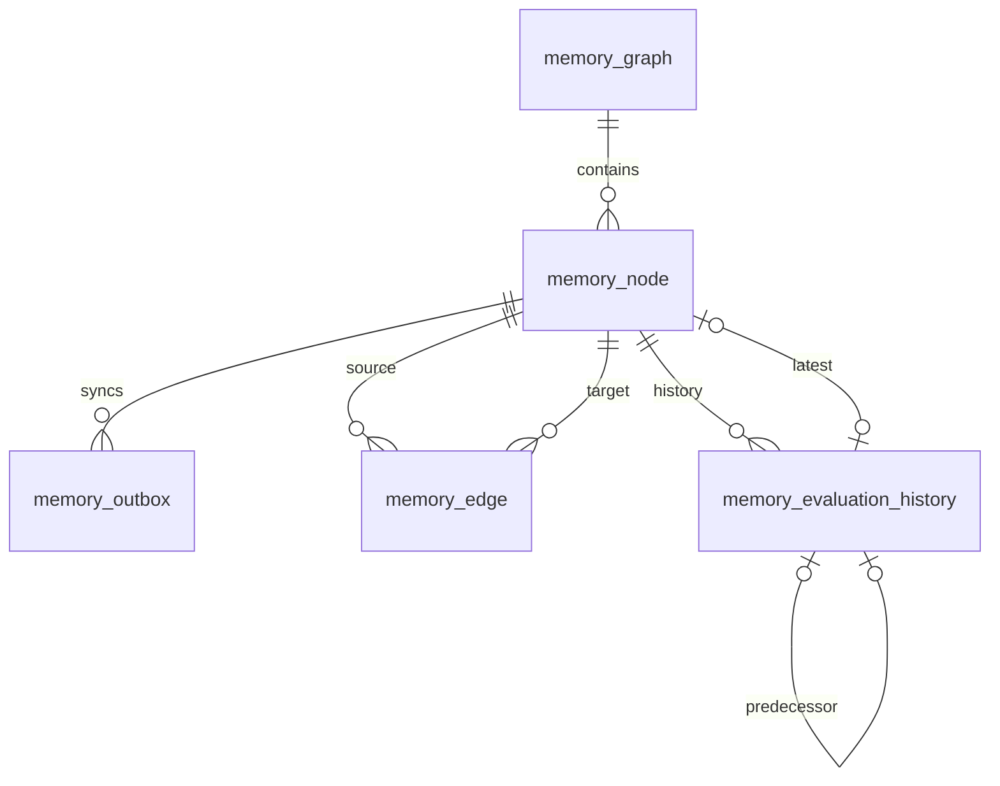

# Agent Memory MySQL 表设计

本文是 GORM 模型和初始迁移的设计稿，以 [当前 Protobuf 契约](../idl/agent_memory.proto) 为准。MySQL 8.4 使用 InnoDB 存储五张表，分别保存图、节点、继承边、评估历史和 Outbox 同步事件。

## 表关系

| 关系 | 基数 | 约束 |
| --- | --- | --- |
| 用户与图 | `1:N`，One-to-Many | 一个 `user_id` 可拥有多张图。用户身份由上游管理，MySQL 存储 `user_id`。 |
| 图与节点 | `1:N`，One-to-Many | 每个节点恰好属于一张图。 |
| 节点与节点 | 有向 `M:N`，Many-to-Many | `memory_edge` 是显式关联表。新节点可指向多个被修改的旧节点，一个旧节点可被不同的新节点引用。同一对端点只允许一条边。 |
| 节点与评估记录 | `1:N`，One-to-Many | 每条评估记录恰好属于一个节点。节点提交时有一条最新评估。 |
| 评估记录与前一条评估 | 可选 `1:1`，自引用 | 初次评估无前驱，后续评估各有一个前驱。每条记录最多被一条后续记录引用，形成单链。 |
| 节点与同步事件 | `1:N`，One-to-Many | 每个事件指向一个目标节点，所属图通过节点取得。首版一次新增或变更事实产生一条同步事件。 |

边和评估记录通过节点归属图。`change_id` 关联同一次操作产生的继承边与 Outbox 事件。每个节点按自身版本串联评估记录。

## 通用类型

| 用途 | MySQL 类型 | Go 类型与约定 |
| --- | --- | --- |
| 系统生成的图、节点、边、评估、变更及租约 ID | `CHAR(36) CHARACTER SET ascii COLLATE ascii_bin` | `string`，可空时用 `*string`。拟使用小写标准文本 UUIDv7，由服务生成。 |
| 五张表的物理主键 | `BIGINT UNSIGNED AUTO_INCREMENT` | `gorm.Model.ID`，Go 类型为 `uint`。HTTP `event_id` 使用 Outbox `id` 的十进制字符串。 |
| 上游用户标识 | `VARCHAR(128) COLLATE utf8mb4_0900_bin` | `string`，大小写敏感。 |
| 创建图的幂等键 | `VARBINARY(128)` | `[]byte`，对原始 UTF-8 字节做精确比较，接受 1–128 字节。 |
| 版本、枚举、尝试次数 | `BIGINT UNSIGNED`、`TINYINT UNSIGNED`、`INT UNSIGNED` | `uint64`、基于 `uint8` 的具名类型、`uint32`。业务枚举沿用当前 Protobuf 数值。 |
| 置信度 | `DOUBLE` | `float64`。拟限制在 `[0, 1]`，服务校验有限值。 |
| 时间 | `DATETIME(6)` | `time.Time`，可空时用 `*time.Time`。默认统一到 UTC 微秒精度。 |
| 状态标记 | `BOOLEAN` | `bool`。 |

表默认字符集为 `utf8mb4`。各外键两端使用相同类型和排序规则。GORM 通过 `CreatedAt` 和 `UpdatedAt` 约定自动写入审计时间。GORM 的时钟、连接会话的 `time_zone` 和驱动的 `loc` 均使用 UTC。业务时间由调用方传入或保持 `NULL`。

## 字段设计

以下字段的默认值以明确列出为准。`ID` 指通用类型表中的 `CHAR(36)`。

### 五张表的共有字段

| 字段 | MySQL 类型 | 可空 | 用途 |
| --- | --- | --- | --- |
| `id` | `BIGINT UNSIGNED AUTO_INCREMENT` | 否 | `gorm.Model` 自增主键。 |
| `created_at` | `DATETIME(6)` | 是 | 由 GORM 创建记录时填充，也是评估的记录时间。 |
| `updated_at` | `DATETIME(6)` | 是 | 由 GORM 更新记录时填充。 |
| `deleted_at` | `DATETIME(6)` | 是 | 软删除时间，普通 GORM 查询筛选 `IS NULL`。 |

### `memory_graph`

| 字段 | MySQL 类型 | 可空 | 用途 |
| --- | --- | --- | --- |
| `graph_id` | `ID` | 否 | 唯一业务标识。 |
| `user_id` | `VARCHAR(128) COLLATE utf8mb4_0900_bin` | 否 | 图所有者。 |
| `version` | `BIGINT UNSIGNED` | 否 | 初始值 `1`，每次图内写入成功递增一次。 |
| `create_idempotency_key` | `VARBINARY(128)` | 否 | 创建图请求的幂等键，按用户唯一。 |

### `memory_node`

| 字段 | MySQL 类型 | 可空 | 用途 |
| --- | --- | --- | --- |
| `node_id` | `ID` | 否 | 唯一节点标识，也是 Milvus 的手动主键。 |
| `graph_id` | `ID` | 否 | 所属图的外键。 |
| `content` | `MEDIUMTEXT` | 否 | 事实正文，创建后固定。 |
| `confidence` | `DOUBLE` | 否 | 当前置信度。 |
| `is_valid` | `BOOLEAN` | 否 | 当前有效状态，初始值 `TRUE`。 |
| `valid_from` | `DATETIME(6)` | 是 | 调用方提供的事实生效时间。 |
| `fix_time` | `DATETIME(6)` | 是 | 现实更新时，调用方提供的旧事实停止成立时间。 |
| `expires_at` | `DATETIME(6)` | 是 | 调用方提供的记忆失效时间。 |
| `latest_evaluation_id` | `ID` | 是 | 最新评估。新建事务中先插入空指针，再写首条评估并补齐。 |
| `version` | `BIGINT UNSIGNED` | 否 | 初始值 `1`。每次追加该节点的评估递增一次。 |

### `memory_edge`

| 字段 | MySQL 类型 | 可空 | 用途 |
| --- | --- | --- | --- |
| `edge_id` | `ID` | 否 | 唯一边标识。 |
| `graph_id` | `ID` | 否 | 边所属的图。两端通过复合外键限定在此图内。 |
| `node_id` | `ID` | 否 | 本次变更新建的节点，出边的起点。 |
| `previous_node_id` | `ID` | 否 | 被新节点修改或纠错的旧节点。 |
| `relation_type` | `TINYINT UNSIGNED` | 否 | `1 = CORRECTION`，`2 = UPDATE`。 |
| `reason` | `TEXT` | 否 | 继承原因。 |
| `change_id` | `ID` | 否 | 产生该边的变更标识。 |
| `graph_version` | `BIGINT UNSIGNED` | 否 | 产生该边时提交的图版本。 |

### `memory_evaluation_history`

| 字段 | MySQL 类型 | 可空 | 用途 |
| --- | --- | --- | --- |
| `evaluation_id` | `ID` | 否 | 唯一评估标识。 |
| `graph_id` | `ID` | 否 | 与 `node_id` 一起限定节点归属。 |
| `node_id` | `ID` | 否 | 被评估的节点。 |
| `previous_evaluation_id` | `ID` | 是 | 同一节点的前一条评估。初始评估为空。 |
| `node_version` | `BIGINT UNSIGNED` | 否 | 评估提交后的节点版本，从 `1` 开始。 |
| `confidence` | `DOUBLE` | 否 | 此版本的置信度评分。 |
| `reason` | `TEXT` | 否 | 评估原因。 |

评估时间取 `gorm.Model.CreatedAt`，响应通过 `evaluated_at` 返回。读取前驱即可取得上一版本的评分。当前有效状态与有效时间保存在节点，纠错和现实更新由继承边记录。

### `memory_outbox`

| 字段 | MySQL 类型 | 可空 | 用途 |
| --- | --- | --- | --- |
| `node_id` | `ID` | 否 | 待同步的节点外键。Worker 按此 ID 读取正文并写入 Milvus。 |
| `change_id` | `ID` | 否 | 同步事件对应的写操作。 |
| `event_type` | `TINYINT UNSIGNED` | 否 | `1 = ADD`，`2 = UPDATE`。 |
| `status` | `TINYINT UNSIGNED` | 否 | `1 = PENDING`，`2 = PROCESSING`，`3 = RETRY_WAIT`，`4 = SUCCEEDED`，`5 = FAILED`。默认 `1`。 |
| `attempts` | `INT UNSIGNED` | 否 | 已领取次数，初始值 `0`。 |
| `next_attempt_at` | `DATETIME(6)` | 是 | 待处理及重试的调度时间。入队时取本条记录的 `created_at`。 |
| `lease_until` | `DATETIME(6)` | 是 | `PROCESSING` 状态下的租约截止。 |
| `lease_token` | `ID` | 是 | 每次领取生成，确认或回写时校验租约归属。 |
| `last_error` | `TEXT` | 是 | 最近一次处理失败的说明。 |
| `processed_at` | `DATETIME(6)` | 是 | 进入成功或最终失败状态的时间。 |

Worker 使用 `node_id` 在关闭 `AutoID` 的 Milvus 集合中执行 `upsert`。索引同步进度由 Outbox 状态记录，所属图和用户通过 `node_id` 关联 `memory_node` 与 `memory_graph` 查询。 [Milvus 手动主键](https://milvus.io/docs/v2.6.x/primary-field.md#use-manual-ids)

## 主键、外键和索引

各表的 `id` 是物理主键。业务标识通过唯一索引定位，外键引用对应的业务唯一键。外键采用 InnoDB 默认的限制更新和删除行为。节点和评估间有双向引用，迁移先创建节点与评估，再添加节点的最新评估外键。各复合外键的目标列采用完整唯一键，外键列按相同顺序放在关联索引的最左侧。 [MySQL 外键约束](https://dev.mysql.com/doc/refman/8.4/en/create-table-foreign-keys.html)

| 外键 | 源表与列 | 目标表与列 |
| --- | --- | --- |
| `fk_node_graph` | `memory_node (graph_id)` | `memory_graph (graph_id)` |
| `fk_edge_from` | `memory_edge (graph_id, previous_node_id)` | `memory_node (graph_id, node_id)` |
| `fk_edge_to` | `memory_edge (graph_id, node_id)` | `memory_node (graph_id, node_id)` |
| `fk_eval_node` | `memory_evaluation_history (graph_id, node_id)` | `memory_node (graph_id, node_id)` |
| `fk_eval_previous` | `memory_evaluation_history (graph_id, node_id, previous_evaluation_id)` | `memory_evaluation_history (graph_id, node_id, evaluation_id)` |
| `fk_node_latest_eval` | `memory_node (graph_id, node_id, latest_evaluation_id)` | `memory_evaluation_history (graph_id, node_id, evaluation_id)` |
| `fk_outbox_node` | `memory_outbox (node_id)` | `memory_node (node_id)` |

| 表 | 索引名 | 类型与列顺序 | 对应约束或查询 |
| --- | --- | --- | --- |
| `memory_graph` | `uk_graph_id` | `UNIQUE (graph_id)` | 按图标识定位和加锁，支撑节点的图外键。 |
| `memory_graph` | `uk_graph_create_request` | `UNIQUE (user_id, create_idempotency_key)` | 创建图幂等查询，也支持按用户查图。 |
| `memory_node` | `uk_node_id` | `UNIQUE (node_id)` | 使用全局节点 ID 定位节点，支撑 Outbox 节点外键。 |
| `memory_node` | `uk_node_graph_node` | `UNIQUE (graph_id, node_id)` | 为同图复合外键提供唯一目标。支持按图批量读节点，也覆盖 `fk_node_graph`。 |
| `memory_node` | `idx_node_latest_eval` | `(graph_id, node_id, latest_evaluation_id)` | 支撑最新评估外键。 |
| `memory_node` | `idx_node_current_confidence` | `(graph_id, is_valid, confidence)` | 当前检索先按图和有效标记筛选，可接置信度下限。业务时间在候选集上继续判断。 |
| `memory_edge` | `uk_edge_id` | `UNIQUE (edge_id)` | 约束边业务标识唯一。 |
| `memory_edge` | `uk_edge_pair` | `UNIQUE (graph_id, previous_node_id, node_id)` | 同一对端点去重，支持检查旧节点是否被纠错。 |
| `memory_edge` | `idx_edge_forward` | `(graph_id, node_id, previous_node_id)` | BFS 批量按新节点找出边，按端点稳定排序。 |
| `memory_edge` | `idx_edge_change` | `(change_id)` | 查询同一次变更产生的边。 |
| `memory_evaluation_history` | `uk_eval_id` | `UNIQUE (evaluation_id)` | 约束评估业务标识唯一，支持按分页游标定位记录。 |
| `memory_evaluation_history` | `uk_eval_node_id` | `UNIQUE (graph_id, node_id, evaluation_id)` | 为同节点的前驱和最新评估外键提供唯一目标。 |
| `memory_evaluation_history` | `uk_eval_node_version` | `UNIQUE (graph_id, node_id, node_version)` | 节点每一版本只有一份评估，支持评估链降序分页。 |
| `memory_evaluation_history` | `uk_eval_predecessor` | `UNIQUE (graph_id, node_id, previous_evaluation_id)` | 每个非空前驱最多被消费一次，覆盖前驱外键。 |
| `memory_outbox` | `uk_outbox_change` | `UNIQUE (change_id)` | 首版每次写入至多一条事件，支持按变更查询。软删除行继续占用该唯一键。 |
| `memory_outbox` | `idx_outbox_node` | `(node_id)` | 支撑目标节点外键及按节点查询。 |
| `memory_outbox` | `idx_outbox_ready` | `(status, next_attempt_at)` | 按单一状态领取到期的 `PENDING` 或 `RETRY_WAIT`，按 `next_attempt_at, id` 排序。 |
| `memory_outbox` | `idx_outbox_lease` | `(status, lease_until)` | 按 `PROCESSING` 状态回收过期租约，按 `lease_until, id` 排序。 |
| 五张表 | `idx_<表名>_deleted_at` | `(deleted_at)` | `gorm.Model` 声明的软删除索引。 |

队列扫描使用 `status = ?` 作为等值条件，再对时间列做范围查询。InnoDB 二级索引附带主键 `id`，时间相同时继续按 `id` 排序。`deleted_at IS NULL` 作为队列查询的过滤条件。节点检索的置信度索引用于筛选候选，最终 TopK 由 Milvus 排序。 [MySQL 索引扩展](https://dev.mysql.com/doc/refman/8.4/en/index-extensions.html)

行级 `CHECK` 覆盖以下约束。MySQL 唯一索引允许多个 `NULL`，因此首条评估的唯一性同时依靠版本唯一键和前驱规则。 [MySQL 唯一索引](https://dev.mysql.com/doc/refman/8.4/en/create-index.html) · [MySQL CHECK 约束](https://dev.mysql.com/doc/refman/8.4/en/create-table-check-constraints.html)

- 图和节点的版本从 `1` 起。节点置信度和评估置信度在 `[0, 1]` 范围内，逻辑字段只接受 `0` 和 `1`。
- 边要求 `node_id <> previous_node_id`。事务将本次新建的节点作为出边起点。
- 评估初始行要求 `node_version = 1` 且前驱为 `NULL`。后续行要求 `node_version > 1` 且前驱非空，外键限制其属于同一节点。更新节点时再校验前驱是上一版本的链头。
- 边和 Outbox 的业务枚举使用字段表中的合法值。

| Outbox 状态 | 有值字段 | 空字段 |
| --- | --- | --- |
| `PENDING`、`RETRY_WAIT` | `next_attempt_at` | `lease_until`、`lease_token`、`processed_at` |
| `PROCESSING` | `lease_until`、`lease_token` | `next_attempt_at`、`processed_at` |
| `SUCCEEDED`、`FAILED` | `processed_at` | `next_attempt_at`、`lease_until`、`lease_token` |

Outbox 状态与时间列一起更新并由行级 `CHECK` 校验。`last_error` 随处理结果更新。

历史检索用业务时间窗口筛选节点，并通过指向旧节点的 `CORRECTION` 边排除被纠错的事实。区间筛选使用 `valid_from < end`、`fix_time > start` 和 `expires_at > start`，空值表示对应边界不限。关系追溯沿出边查询，也用这些业务时间筛选旧节点。

## 写入、幂等与分页

1. 图内写入先按唯一 `graph_id` 锁定图记录，再校验所有者、预期图版本及接口要求的预期节点版本。旧版本请求返回版本冲突。
2. 同事务写入节点、评估、继承边和适用的 Outbox 事件，推进图版本。对既有节点追加评估时，以锁内所读链头作为前驱，写评估后同步推进节点版本与链头。新节点提交之前补齐 `latest_evaluation_id`。
3. `CreateGraph` 按 `(user_id, create_idempotency_key)` 去重，因为创建前没有图版本可校验。
4. 评估分页先查游标所属图和节点，再按 `node_version < 游标版本`、`node_version DESC` 取 `limit + 1` 条。存在下一页时，游标返回本页最后一条已返回记录的 `evaluation_id`。
5. Outbox Worker 分状态查询到期事件，用短事务执行 `FOR UPDATE SKIP LOCKED` 并提交领取状态，再执行外部同步。回写时匹配 `id`、`status`、`lease_token` 及有效租约。使用原生 SQL 时，领取、回收和回写都显式带上 `deleted_at IS NULL`。 [MySQL 锁定读](https://dev.mysql.com/doc/refman/8.4/en/innodb-locking-reads.html) · [GORM 软删除](https://gorm.io/docs/delete.html#Soft-Delete)

## GORM 映射与迁移

- `app/agent_memory/biz/model` 的五个模型都嵌入 `gorm.Model`，用 `TableName()` 固定表名。业务 UUID 独立声明类型和适用的唯一索引，可空业务时间使用 `*time.Time`。 [GORM 模型声明](https://gorm.io/docs/models.html)
- 每组查询定义在对应的模型文件中，构造函数接收 `context.Context` 与 `*gorm.DB`。连接由 `biz/dal` 初始化，事务内将当前的 `tx` 传给构造函数。
- 迁移显式使用表类型、排序规则、命名的复合索引和外键，按依赖顺序建表，最后添加 `fk_node_latest_eval`。多列索引若同时用模型标签表达，采用相同索引名并用 `priority` 固定顺序。 [GORM 迁移](https://gorm.io/docs/migration.html) · [GORM 索引](https://gorm.io/docs/indexes.html)
- 节点关联所属图，Outbox 关联目标节点，两者都用 `belongs to`。边的两端用 `GraphID,NodeID` 和 `GraphID,PreviousNodeID` 关联节点。业务以 `MemoryEdge` 显式写关联行，事务同时保存关系类型、原因、图版本和变更 ID。 [GORM Belongs To](https://gorm.io/docs/belongs_to.html) · [GORM Many To Many](https://gorm.io/docs/many_to_many.html)
- 软删除行继续受唯一索引和外键约束。跨表查询按业务关系检查相关行的 `deleted_at`，评估链的读取保留对历史前驱的访问。更新节点使用显式列或 `Updates(map[string]any{...})`，使 `false`、`0` 和 `NULL` 能按业务要求写入。 [GORM 软删除](https://gorm.io/docs/delete.html#Soft-Delete) · [GORM Update](https://gorm.io/docs/update.html)
