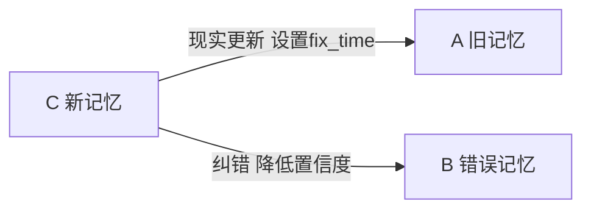

# Agent Memory 项目综述

Agent Memory 是一个 Go HTTP/JSON 服务，接收模型生成的记忆，保存节点、继承关系和评估历史，通过 Outbox 将节点索引同步到 Milvus。项目围绕 MySQL、建图过程和检索展开，不提供拆分功能或业务定时任务。

本文按当前讨论收敛设计，日期为 2026 年 11 月 20 日。“事实”是对外操作使用的称呼，节点本身仍是模型形成的记忆结果。

## 已明确的核心语义

- MySQL 使用图、节点、边、评估历史、Outbox 五张表。
- 节点隶属于图，边连接具体节点并保存变化原因。
- 评估历史形成链条；节点表保存当前评分，历史表保存每次变化及理由。
- 内容变化创建新节点和继承边，并处理指定旧节点；旧内容保留。
- 错误降低旧节点置信度；现实更新给旧节点设置 fix_time。
- fix_time 是旧事实停止有效的时间，不是系统修改时间。
- Milvus 保存节点检索表示，不保存图边和评估历史。
- Outbox 一张表，区分 ADD、UPDATE 两类事件。
- 置信度与时间是检索筛选条件，最终 TopK 按 Milvus 语义或混合相关性排序。
- 图追溯按结束时间或层数停止，并受 limit 限制。

## 服务形态与职责

首版采用 Go 与 Hertz 封装 HTTP/JSON 服务，内部划分记忆写入、关系追溯、问题检索和 Outbox Worker。Worker 是持续的异步消费处理，不是定时任务系统。

上层模型或调用方形成新事实、继承关系、评估结果和变化原因。服务负责校验、事务保存、维护评估链及同步索引。本轮不另设模型运行表、图变换表或事实推理关系图。

| 组件 | 职责 |
| --- | --- |
| MySQL | 图、节点、边、评估历史和 Outbox 的权威存储 |
| Go 服务 | 业务校验、事务提交、关系追溯、检索编排与结果组装 |
| Outbox Worker | 消费 ADD/UPDATE，生成或复用向量，幂等写入 Milvus |
| Milvus | 在指定节点范围内执行语义或混合相关性检索 |

## MySQL 五张表

以下为逻辑字段设计。字段类型、关系基数、索引与 GORM 映射见 [MySQL 表设计](MYSQL_SCHEMA.md)。

五张表都嵌入 `gorm.Model`，使用自增 `id`、自动审计时间和软删除。业务接口通过图、节点、边和评估各自的业务标识访问记录。

### 图表 memory_graph

核心字段包括 `graph_id`、`user_id`、`version`、`create_idempotency_key`、`created_at`、`updated_at`。

保存图的身份和所属范围。version 用于图级并发校验，不另设图头表。请求携带预期版本，一次图操作成功提交后递增版本，避免旧状态操作覆盖新变化。

### 节点表 memory_node

建议字段：node_id、graph_id、content、confidence、is_valid、valid_from、fix_time、expires_at、latest_evaluation_id、created_at、updated_at、version。

content 创建后不覆盖，内容变化创建新节点。confidence、is_valid、fix_time 等当前值可以更新，但必须同步追加评估历史。latest_evaluation_id 指向该节点最新的评估记录。

| 字段 | 语义 |
| --- | --- |
| confidence | 当前采用的置信度评分 |
| is_valid | 当前操作状态下是否允许使用；不能单独代替历史有效时间判断 |
| valid_from | 事实开始有效的时间；未知时不以创建时间伪装现实起点 |
| fix_time | 旧事实停止有效的时间；为空表示尚未记录结束时间 |
| expires_at | 短时记忆可用截止时间，与 fix_time 分开 |
| created_at | 系统创建节点的时间 |
| latest_evaluation_id | 当前评估链头，用于原子更新与追溯 |

### 边表 memory_edge

核心字段包括 `edge_id`、`graph_id`、`node_id`、`previous_node_id`、`relation_type`、`reason`、`change_id`、`graph_version`。

方向统一为新节点指向它更新或纠错的旧节点。按 `node_id` 取出边即可查询该节点改了谁。同一次操作涉及多个旧节点时，出边共享 `change_id`，每条边记录自己的关系类型和原因。

边的 `created_at` 记录关系写入时间，`fix_time` 表示旧事实停止成立的业务时间。边两端属于同一图，出边由本次新建节点指向既有节点。

### 评估历史表 memory_evaluation_history

每条评估记录包含所属图和节点、评估 ID、节点版本、前一条评估 ID、评分与原因。评估时间使用 GORM 自动写入的 `created_at`。

第 1 版的 `previous_evaluation_id` 为 `NULL`。后续评估指向上一版本，同一事务更新节点评分、版本与 `latest_evaluation_id`。版本或链头变化时返回冲突。仅调分时复用原节点。

### Outbox 表 memory_outbox

Outbox 使用 `gorm.Model` 的自增 `id` 与软删除时间。表中保存 `node_id`、`change_id`、事件类型、同步状态和重试信息。`node_id` 定位待同步节点，也作为 Milvus 主键。Outbox 与节点、边、评估历史在同一个 MySQL 事务中提交。

`change_id` 关联同一次操作的继承边与 Outbox 事件。

## 新增 更新与纠错

### 新增事实

调用方提交图、预期图版本、新记忆内容、初始评分、有效时间或短时期限及原因。服务校验后，在同一事务中创建节点、写初始评估、推进图版本并插入 ADD 事件。没有旧节点时不创建继承边。

### 更新或纠错

调用方提交新事实、继承边、每个旧节点的处理方式和原因。旧节点逐个明确属于错误纠正或现实更新，不能整组统一处理。

| 情况 | 旧节点处理 | 历史含义 |
| --- | --- | --- |
| 错误纠正 CORRECT | 标记当前失效，降低 confidence，追加评估原因 | 旧内容是被纠正的记忆，不能包装成真实历史 |
| 现实更新 UPDATE | 标记当前失效，设置 fix_time，原置信度默认不降低 | 旧内容过去可以成立，从 fix_time 起不再有效 |

新节点保存自己的评分。错误降分的幅度由明确评估结果或评分规则提供；设置 fix_time 不等于把过去真实的记忆判错。

同一事务完成：校验旧节点和预期版本 → 创建新节点 → 创建继承边 → 更新旧节点状态、评分或 fix_time → 追加相关评估链 → 递增图版本 → 插入 UPDATE 事件。任一步失败全部回滚。

节点正文和旧边保留。当前查询排除失效节点。历史查询使用节点的业务有效时间与继承边类型区分现实更新和纠错。

## ADD 与 UPDATE 的 Outbox 消费

| 类型 | 业务含义 | Milvus 处理 |
| --- | --- | --- |
| ADD | 新增记忆节点 | 为新节点生成检索向量，按 node_id 幂等写入 |
| UPDATE | 新事实接替或纠正旧节点，携带继承关系和旧节点处理 | 写入新输出节点的向量；评分、fix_time 和失效状态在 MySQL 生效 |

Milvus 保存节点同步时的评分和业务时间。旧节点评分或业务时间变更后，当前查询仍按 MySQL 的最新状态确定允许参与的节点范围。已有的旧向量可以保留供历史检索。

Worker 作为独立进程运行。它在短事务内用 `FOR UPDATE SKIP LOCKED` 领取事件，记录租约并递增尝试次数。提交领取后从 MySQL 读取完整节点，由 Eino Indexer 调用 Qwen Embedding，再按 `node_id` 写入 Milvus。回写结果时校验事件状态、租约令牌和期限。Milvus 写入成功但 MySQL 确认丢失时，重复处理仍使用同一个主键。

处理失败或租约过期都使用同一重试上限，默认共 5 次领取。重试等待时间随尝试次数指数增长并加入随机抖动，`next_attempt_at` 由数据库当前 UTC 时间加等待时间得到。用尽次数、事件类型不受支持或节点已不可用时，标记为 `FAILED` 并保留错误。

主库已提交和向量已可检索分别表达。未同步新节点可能暂时搜不到，可查询同步状态；重试只处理同步，不重新调用模型产生不同记忆。

## 图关系追溯

追溯操作接收 `graph_id`、一组 `node_ids`、结束条件和 `limit`。服务在同一 MySQL 读快照中沿新节点的出边逐层查找旧节点。

| 模式 | 参数 | 含义 |
| --- | --- | --- |
| 时间区间 | `end_time`、可选 `start_time` | 所有起点共享 `[end_time, start_time)`。省略上界时取起点中最晚的已知生效时间，全部未知时取请求时刻。旧节点与该区间相交时进入结果并继续展开。 |
| 层数结束 | max_depth | 向历史最多展开指定层数，起点为第 0 层 |

`limit` 是本次最多返回的去重节点数，范围 1 至 100，包含所有起点。若预算跳过了仍可展开的旧节点，返回 `truncated` 和有未展开出边的节点及其深度。边保留 `change_id`，响应的 `graph_version` 对应本次读快照。

## 问题检索与 TopK

以最新澄清为准：置信度与时间决定节点是否有资格参与检索，最终 TopK 按 Milvus 语义或混合相关性排序。它们不是业务排序模式，也不是先按置信度或时间排出 K 条。

1. 固定图范围、图版本与查询时刻，接收问题、top_k、置信度和时间条件。
2. MySQL 确定满足条件的节点 ID 集合，包括归属、有效状态、置信度门槛和时间要求。
3. 在全部合格且已同步的节点范围内，由 Milvus 执行语义或混合检索。
4. 混合检索各分支使用同一节点范围，融合后按相关性返回 TopK。
5. 回 MySQL 读取正文并核验状态，保留 Milvus 排序；有并发变化时补查或按新版本重试。

混合检索的两个分支都应用相同的图 ID 和 MySQL 候选节点 ID。Milvus 的评分、有效状态和业务时间是异步同步的副本，检索资格以 MySQL 为准。 [过滤检索文档](https://milvus.io/docs/filtered-search.md)

不能先取未过滤的 TopK 再删除无效节点，这会漏掉本应入选的合格节点。ID 集合过大时，应明确返回范围过大或要求缩小查询，不能偷偷截断白名单。大规模优化后续单独设计。

`valid_at` 检查给定时刻是否落在节点的业务有效区间内，`valid_range` 检查两个半开区间是否相交。节点有效区间以 `valid_from` 为起点，以 `fix_time` 和 `expires_at` 中最早的非空值为终点，空边界表示无限制。历史事实检索会排除被纠错的节点。

最终相关性由配置的向量召回与融合算法决定；近似索引和分支候选预算是检索实现参数，不能把它们误认为置信度排序。

### 混合检索字段

Qwen 稠密向量使用余弦相似度，Milvus 使用 Jieba 分词从正文生成 BM25 稀疏向量。Eino Retriever 将两路结果用 RRF 融合。 [混合检索文档](https://milvus.io/docs/multi-vector-search.md) · [全文检索文档](https://milvus.io/docs/full-text-search.md)

| 字段 | 类型 | 用途 |
| --- | --- | --- |
| `node_id`、`graph_id` | `VarChar(36)` | 节点主键、图归属 |
| `content` | `VarChar(65535)` | BM25 使用的节点正文 |
| `vector`、`sparse_vector` | `FloatVector`、`SparseFloatVector` | Qwen 编码与 Milvus BM25 |
| `confidence`、`is_valid` | `Double`、`Bool` | 同步时的置信度和有效状态 |
| `valid_from`、`fix_time`、`expires_at` | 可空 `Int64` | 节点生效、事实停止成立和记忆到期时间，保存为 Unix 微秒时间戳 |

## 短时记忆

短时记忆保留 expires_at，MySQL 在当前检索资格筛选时排除到期节点，无需定时扫描，正文、边和评估历史继续保留。

fix_time 是现实事实结束时间，expires_at 是记忆可用期结束时间。重复同步、普通读取和重新评分不自动续期；新节点到期也不自动恢复被它替代的旧节点。

## 对外接口范围

首版以以下服务能力为主，具体路径与字段在表语义固定后再定。

| 接口能力 | 输入重点 | 输出重点 |
| --- | --- | --- |
| 创建或查询图 | 用户与图标识 | 图信息与当前版本 |
| 新增事实 | 内容、评分、时间、原因 | 节点 ID、图版本、ADD 事件 |
| 更新或纠错 | 新事实、继承边、旧节点处理与原因 | 新旧节点结果、评估记录、UPDATE 事件 |
| 节点详情与评估链 | 节点 ID 和历史范围 | 正文、当前状态、历次评分和原因 |
| 关系追溯 | 起点集合、end_time 或 max_depth、limit | 节点、关系、边界和截断状态 |
| 问题 TopK | 问题、置信度与时间条件、top_k | 按相关性排序的正文和检索分数 |
| 同步状态 | event_id 或 change_id | Outbox 状态、尝试次数和错误 |

## 一致性与验收

同一请求重试不能重复产生节点、边、评估或事件。每条边的两端属于同一授权图。新节点、继承边、旧节点评分或时间变更、评估链和 Outbox 必须同事务提交。

验收覆盖：错误降分但不伪造事实结束时间；现实更新设置 fix_time 而不无故降低历史置信度；评估链与当前评分一致；ADD 和 UPDATE 共用一表；多个起点的回溯正确停止；limit 不被突破；业务过滤先于 TopK；最终按相关性排序；索引失败可重试；确认丢失可幂等消费；历史节点保留。
